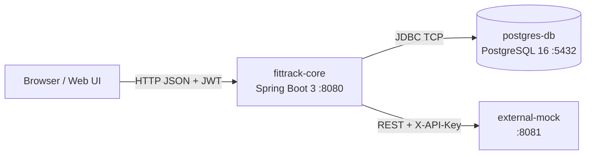

# FitTrack Distributed

Θέμα 3: προσωπική γυμναστική, προπονήσεις και ραντεβού με trainers. Το repository περιέχει τον βασικό σκελετό v0.1.

## Αρχιτεκτονική



Το browser UI, το core API, η PostgreSQL και το εξωτερικό black-box mock είναι τέσσερις διεργασίες. Τα τρία τελευταία τρέχουν ως containers στο απομονωμένο Docker network `fittrack-net`.

## Εκτέλεση με Docker Compose

1. Αντίγραψε το `.env.example` ως `.env` (`Copy-Item .env.example .env` σε PowerShell ή `cp .env.example .env` σε Bash).
2. Από τον φάκελο του repository τρέξε:

   ```sh
   docker compose up --build
   ```

3. Το API είναι στο `http://localhost:8080`, η PostgreSQL στο `localhost:5432` και το mock service στο `http://localhost:8081`.
4. Για διακοπή: `docker compose down`. Για διαγραφή και των δεδομένων της τοπικής βάσης: `docker compose down -v`.

Οι τιμές του `.env.example` είναι μόνο για τοπική ανάπτυξη. Μην αποθηκεύετε πραγματικά secrets στο Git.

Το mock API προσφέρει `GET /api/v1/exercises?muscleGroup=...` και `POST /api/v1/calendar/events`. Οι κλήσεις API απαιτούν `X-API-Key`. Το GET επιστρέφει ενδεικτικές ασκήσεις· το POST επιστρέφει `externalEventId` χωρίς μόνιμη αποθήκευση.

## Εκτέλεση μόνο της εφαρμογής

Απαιτείται Java 21. Από το `fittrack-core/`:

```sh
sh ./mvnw spring-boot:run
```

Σε Windows PowerShell: `./mvnw.cmd spring-boot:run`.

## Δομή repository

- `fittrack-core/`: Spring Boot 3 API, Java 21, Spring Security/JWT, JPA/PostgreSQL.
- `external-mock-service/`: ανεξάρτητο black-box mock service στην πόρτα 8081.
- `docs/`: PDF/DOCX τεχνική αναφορά v0.1 και περιγραφή ρόλων/use cases.
- `docker-compose.yml`: app, PostgreSQL 16 και external mock.
- `.env.example`: πρότυπο τοπικών ρυθμίσεων χωρίς production secrets.

## Έγγραφα

- [Ρόλοι και βασικές περιπτώσεις χρήσης](docs/roles-and-use-cases.md)
- [Τεχνική αναφορά v0.1 PDF](docs/FitTrack_Report_v0.1.pdf)
- [Τεχνική αναφορά v0.1 DOCX](docs/FitTrack_Report_v0.1.docx)
